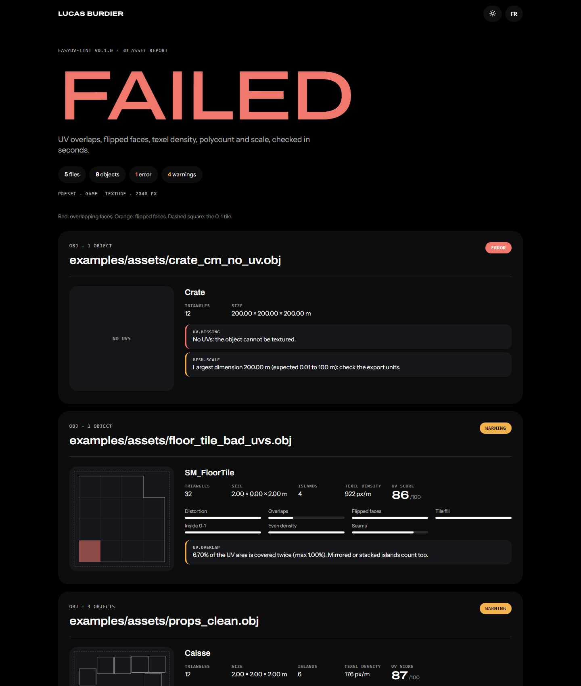

[English](README.md) · **Français**

# easyuv-lint

**Repère les assets 3D cassés avant qu'ils n'arrivent dans ton jeu.** easyuv-lint vérifie les fichiers OBJ, glTF, GLB et FBX : chevauchements d'UV, faces retournées, densité de texels, nombre de polygones, erreurs d'échelle et noms, sur ta machine ou à chaque pull request.

Il est gratuit, open source et propulsé par le moteur [EasyUV](https://github.com/lburdier/EasyUV) : les mesures d'UV sont exactes, pas estimées sur une grille basse résolution.



- **GitHub Action** : annotations sur les fichiers fautifs, résumé dans la page du job, et rapport HTML avec l'aperçu des UV.
- **Ligne de commande** pour Windows, Linux et macOS : un seul exécutable, sans dépendance.
- **Préréglages** jeu, mobile, web et film, et un petit `easyuv-lint.toml` pour régler chaque règle.
- Messages et rapports **en anglais et en français**.

## L'ajouter à ton workflow

```yaml
# .github/workflows/assets.yml
name: 3D assets
on: [push, pull_request]

jobs:
  lint:
    runs-on: ubuntu-latest
    steps:
      - uses: actions/checkout@v4
      - uses: lburdier/easyuv-lint@v0
        with:
          paths: Assets/Models
          preset: game
          lang: fr
```

Entrées :

| Entrée | Défaut | Description |
|---|---|---|
| `paths` | `.` | Fichiers ou dossiers à vérifier, séparés par des espaces ou des retours à la ligne |
| `preset` | | `game`, `mobile`, `web` ou `film` |
| `config` | | Chemin d'un `easyuv-lint.toml` (par défaut : celui à la racine, s'il existe) |
| `texture-size` | | Taille de texture en px pour la densité de texels |
| `strict` | `false` | Échoue aussi sur les avertissements |
| `lang` | `en` | `en` ou `fr` |
| `report` | `easyuv-lint-report.html` | Chemin du rapport HTML, vide pour s'en passer |
| `upload-report` | `true` | Envoie le rapport HTML comme artefact |
| `version` | `latest` | Un tag de release, `latest` ou `source` |

Sorties : `errors`, `warnings`, `passed`.

## L'utiliser en local

Télécharge l'exécutable pour ton système sur la page des [releases](https://github.com/lburdier/easyuv-lint/releases/latest), ou compile-le :

```bash
cargo install --git https://github.com/lburdier/easyuv-lint
```

```bash
easyuv-lint Assets/Models                # vérifie un dossier
easyuv-lint hero.fbx --preset mobile     # un fichier, budget mobile
easyuv-lint . --html rapport.html        # avec le rapport HTML
easyuv-lint . --format json              # pour les scripts
easyuv-lint . --lang fr                  # messages en français
easyuv-lint --list-rules --lang fr       # toutes les règles et leurs valeurs
```

Codes de sortie : `0` aucune erreur, `1` erreurs trouvées (ou avertissements avec `--strict`), `2` utilisation invalide.

## Ce qu'il vérifie

| Règle | Défaut | Ce qu'elle repère |
|---|---|---|
| `uv.missing` | erreur | L'objet n'a pas d'UV |
| `uv.overlap` | avertissement, max 1 % | Surface UV couverte deux fois (les îlots en miroir ou empilés comptent aussi) |
| `uv.flipped` | avertissement, max 0 | Faces en miroir par rapport à leur îlot |
| `uv.outside` | avertissement, max 1 % | UV hors de la tuile 0-1 (à désactiver pour les UDIM) |
| `uv.distortion` | avertissement, max 0,15 | Angles et aires étirés |
| `uv.density_spread` | avertissement, max 30 % | Densité de texels qui change d'un îlot à l'autre |
| `uv.density` | désactivée | Densité de texels hors d'une plage en px/m |
| `uv.score` | avertissement, min 60 | Score EasyUV global sur 100 |
| `mesh.tris` | erreur, max 100 000 | Budget de triangles |
| `mesh.degenerate` | avertissement, max 0 | Faces écrasées ou d'aire nulle |
| `mesh.nonmanifold` | avertissement, max 0 | Arêtes partagées par plus de deux faces |
| `mesh.ngons` | désactivée | Faces de plus de quatre côtés |
| `mesh.scale` | avertissement, 0,01 à 100 m | Erreurs d'unités (une caisse exportée en centimètres) |
| `name.pattern` | désactivée | Noms d'objets qui ne respectent pas ta convention |

## Préréglages

| Préréglage | Triangles | Texture | En plus |
|---|---|---|---|
| `game` | 100 000 | 2048 px | Les valeurs par défaut ci-dessus |
| `mobile` | 15 000 | 1024 px | Densité de texels de 256 à 1024 px/m, n-gones signalés |
| `web` | 50 000 | 2048 px | Pour three.js et les autres visionneuses glTF |
| `film` | sans limite | 2048 px | Plus tolérant sur la distorsion et le score |

## Configuration

Place un `easyuv-lint.toml` à la racine de ton dépôt :

```toml
preset = "game"
texture_size = 2048
ignore = ["ThirdParty/"]

[rules]
"uv.overlap" = { level = "error", max = 0.5 }
"uv.outside" = "off"
"uv.density" = { min = 512, max = 1024 }
"mesh.tris" = { max = 25000 }
"name.pattern" = { pattern = "^(SM|SK)_[A-Za-z0-9_]+$" }
```

Une règle prend un niveau (`"off"`, `"info"`, `"warning"`, `"error"`) ou une table avec `level`, `min`, `max` ou `pattern`. Donner des paramètres à une règle désactivée l'active en avertissement. Voir [`examples/easyuv-lint.toml`](examples/easyuv-lint.toml).

## À savoir

- OBJ et glTF sont lus en mètres, le FBX est converti en mètres.
- Les UV glTF sont retournées dans la convention OBJ (V vers le haut) : tous les formats sont mesurés de la même façon.
- Les chevauchements sont mesurés objet par objet. Les îlots en miroir ou empilés sont souvent voulus : passe `uv.overlap` en `info` ou augmente son `max` si ton pipeline s'en sert.

## Contribuer

Les issues et pull requests sont les bienvenues, en anglais ou en français. Bonnes premières contributions : nouveaux préréglages (Unreal, Unity, Godot), nouvelles règles, nouveaux formats, traductions.

```bash
cargo test --release
cargo run --release -- examples/assets --html rapport.html
```

## Licence

[GPL-3.0-or-later](LICENSE), comme le moteur EasyUV sur lequel il repose.

Créé par [Lucas Burdier](https://lburdier.fr).
